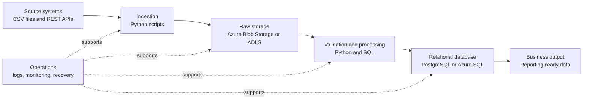

# ShopSphere architecture

## Purpose and status

This is the learning architecture for a fictional online retailer, ShopSphere,
and its Retail Business Cloud Operations & Data Platform. It is a planned
target, not a description of a deployed application. Only the local workspace,
editor configuration, Python environment, Git repository, and pre-existing
PostgreSQL service have been verified. The local `shopsphere` database and
least-privilege `shopsphere_app` role have been created for learning; no
application, data pipeline, or cloud resource exists yet.

## Planned data flow

Concrete service choices and cloud resources are deferred until requirements,
security, current pricing, and learning objectives are reviewed. This diagram
is a system-level learning flow; it does not replace the Module 1 learner-made
business requirements or system context deliverables.

## Components and implementation status

| Component | Intended responsibility | Current status |
|---|---|---|
| Retail source systems | Provide customer, product, order, payment, and shipment data through files or APIs | Planned; no source integration |
| Ingestion | Collect and retain source data with Python | Planned; no code |
| Raw storage | Preserve incoming files in Azure Blob Storage or ADLS | Planned; no cloud resource |
| Validation and processing | Validate, clean, and transform records with Python and SQL | Planned; no pipeline |
| Database | Support relational learning locally with PostgreSQL, with Azure SQL as a later comparison | PostgreSQL 18.6 is reachable on port 3000; `shopsphere` and `shopsphere_app` exist; administrator authentication and a read-only application-role Python connection were verified |
| Business output | Provide reporting-ready data for retail and operational questions | Planned; no reports |
| Operations | Record logs, monitor health, handle incidents, and document recovery | Planned; no project runbooks or monitoring |

## Business context

ShopSphere is an online retailer whose workflows include product browsing,
orders, payment authorization, fulfillment, shipment, delivery, and returns.
Future modules will examine customers, products, orders, order items, payments,
shipments, operational users, and reporting users. Requirements and
stakeholder-specific needs are to be established by the learner in the
appropriate syllabus phase, not assumed by this blueprint.

## Boundaries and principles

- Build one small, testable increment at a time and record actual evidence.
- Keep credentials and real customer data out of source control.
- Use synthetic sample data unless data use is explicitly approved.
- Keep the local Python environment project-scoped.
- Do not alter the existing PostgreSQL service or port as part of setup.
- Do not create cloud resources or incur charges without an explicit, reviewed
  learning task and cost check.
- Update this document when a planned component becomes implemented and
  verified; distinguish configured, connected, authenticated, and tested.
